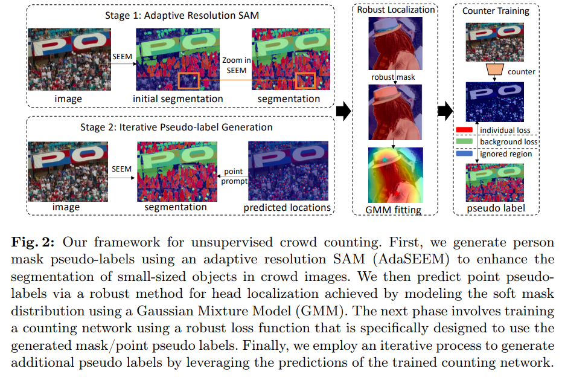

# AdaSEEMCount



## 1. Introduction

<!-- [ALGORITHM] -->

```BibTeX
@inproceedings{wan2025robust,
  title={Robust Zero-Shot Crowd Counting and Localization With Adaptive Resolution SAM},
  author={Wan, Jia and Wu, Qiangqiang and Lin, Wei and Chan, Antoni},
  booktitle={European Conference on Computer Vision},
  pages={478--495},
  year={2025},
  organization={Springer}
}
```

## 2. To install the environment, run the following script:
```shell
bash scripts/install.sh
```

## 3. To download pretrained weights, run the following script:
```shell
bash scripts/download_weights.sh
```

## 4. To process the dataset, run the following script:
```shell
bash scripts/process_dataset.sh
```

## 5. To train and test the model for the ShanghaiTech dataset, run the following script:
```shell
bash scripts/train_sha.sh
```

## 6. Acknowledgement
* [jia-wan/AdaSEEMCount_pytorch](https://github.com/jia-wan/AdaSEEMCount_pytorch)
