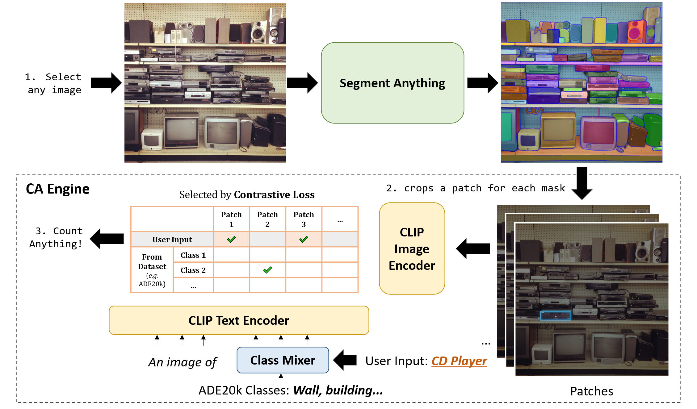

# Count-Anything



## 1. Introduction

<!-- [ALGORITHM] -->

```BibTeX
@misc{yan2023count,
    title = {Count Anything},
    author = {Yan, Liqi},
    howpublished = {\url{https://github.com/ylqi/Count-Anything}},
    year = {2023}
}
```

## 2. To install the environment, run the following script:
```shell
bash scripts/install.sh
```

## 3. To test the model for an image, run the following script:
```shell
bash scripts/test.sh
```

## 4. Acknowledgement
* [ylqi/Count-Anything](https://github.com/ylqi/Count-Anything)
