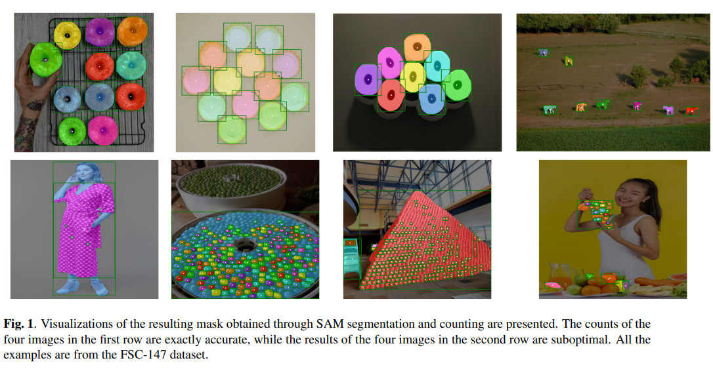

# CountAnything



## 1. Introduction

<!-- [ALGORITHM] -->

```BibTeX
@article{ma2023countanything,
  title={CAN SAM COUNT ANYTHING? AN EMPIRICAL STUDY ON SAM COUNTING},
  author={Ma, Zhiheng and Hong, Xiaopeng and Shangguan Qinnan},
  journal={arXiv preprint arXiv:2304.10817},
  year={2023}
}
```

## 2. To install the environment, run the following script:
```shell
bash scripts/install.sh
```

## 3. To download the pretrained weight, run the following script:
```shell
bash scripts/download_weight.sh
```

## 4. To test the model for FSC-147 and COCO2017 datasets, run the following scripts:
```shell
bash scripts/test_fsc147.sh
bash scripts/test_coco.sh
```

## 5. Acknowledgement
* [Vision-Intelligence-and-Robots-Group/count-anything](https://github.com/Vision-Intelligence-and-Robots-Group/count-anything)
