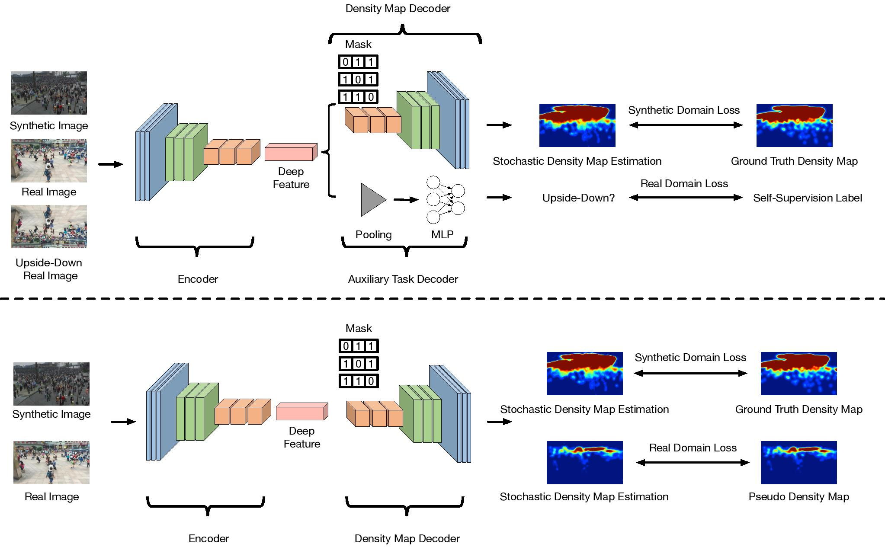

# CDCC



## 1. Introduction

<!-- [ALGORITHM] -->

```BibTeX
@InProceedings{Liu_2022_CVPR,
author = {Liu, Weizhe and Durasov, Nikita and Fua, Pascal},
title = {Leveraging Self-Supervision for Cross-Domain Crowd Counting},
booktitle = {The IEEE Conference on Computer Vision and Pattern Recognition (CVPR)},
month = {June},
year = {2022}
}
```

## 2. To test the model, run the following script:
```shell
bash scripts/test.sh
```

## 3. Acknowledgement
* [weizheliu/Cross-Domain-Crowd-Counting](https://github.com/weizheliu/Cross-Domain-Crowd-Counting)
