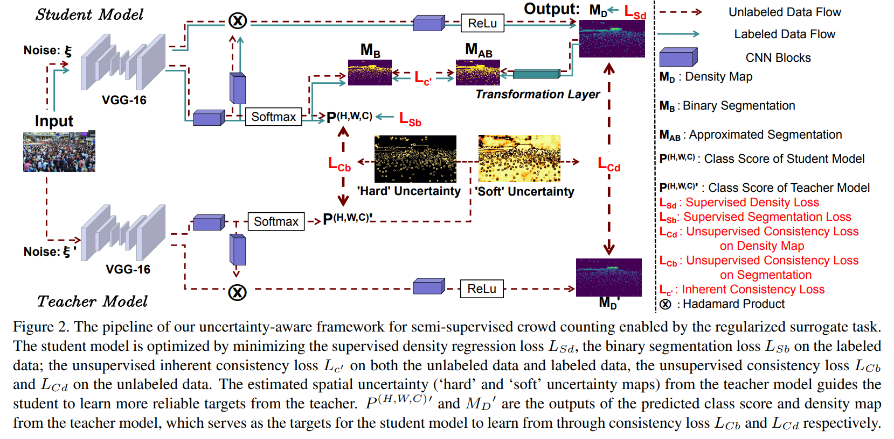

# SUA



## 1. Introduction

<!-- [ALGORITHM] -->

```BibTeX
@InProceedings{Meng_2021_ICCV,
    author    = {Meng, Yanda and Zhang, Hongrun and Zhao, Yitian and Yang, Xiaoyun and Qian, Xuesheng and Huang, Xiaowei and Zheng, Yalin},
    title     = {Spatial Uncertainty-Aware Semi-Supervised Crowd Counting},
    booktitle = {Proceedings of the IEEE/CVF International Conference on Computer Vision (ICCV)},
    month     = {October},
    year      = {2021},
    pages     = {15549-15559}
}
```

## 2. To process the dataset, run the following script:
```shell
bash scripts/process_dataset.sh
```

## 3. To test the model for ShanghaiTech and JHU-Crowd++ datasets, run the following scripts:
```shell
bash scripts/test_sha.sh
bash scripts/test_jhu.sh
```

## 4. Acknowledgement
* [smallmax00/SUA_crowd_counting](https://github.com/smallmax00/SUA_crowd_counting)
