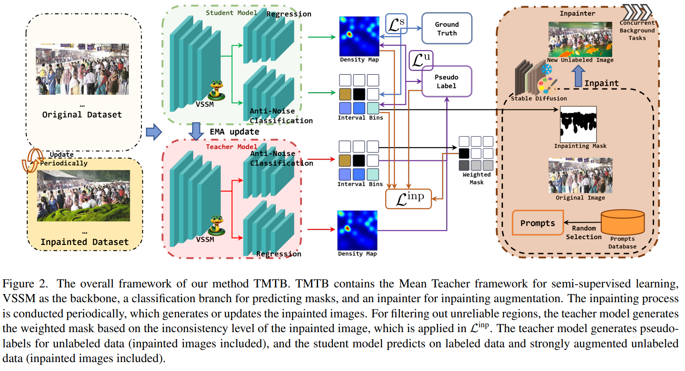

# TMTB



## 1. Introduction

<!-- [ALGORITHM] -->

```BibTeX
@inproceedings{yang2025taste,
  title={Taste more, taste better: Diverse data and strong model boost semi-supervised crowd counting},
  author={Yang, Maochen and Li, Zekun and Zhang, Jian and Qi, Lei and Shi, Yinghuan},
  booktitle={Proceedings of the IEEE/CVF Conference on Computer Vision and Pattern Recognition},
  pages={24440--24451},
  year={2025}
}
```

## 2. To install the environment, run the following scripts:
```shell
bash scripts/install_tmtb.sh
bash scripts/install_inpainting.sh
```

## 3. To download the pretrained weight, run the following script:
```shell
bash scripts/download_weight.sh
```

## 4. To process the dataset, run the following script:
```shell
bash scripts/process_dataset.sh
```

## 5. To train and test the model for the ShanghaiTech dataset, run the following scripts:
```shell
bash scripts/train_sha.sh
bash scripts/test_sha.sh
```

## 6. Acknowledgement
* [syhien/taste_more_taste_better](https://github.com/syhien/taste_more_taste_better)
