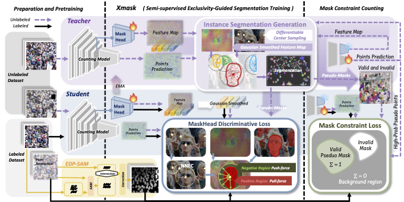

# XMask



## 1. Introduction

<!-- [ALGORITHM] -->

```BibTeX
@misc{huang2026exclusivityguidedmasklearningsemisupervised,
  title={Exclusivity-Guided Mask Learning for Semi-Supervised Crowd Instance Segmentation and Counting},
  author={Jiyang Huang and Hongru Chen and Wei Lin and Jia Wan and Antoni B. Chan},
  year={2026},
  eprint={2603.16241},
  archivePrefix={arXiv},
  primaryClass={cs.CV},
  url={https://arxiv.org/abs/2603.16241}
}
```

## 2. To install the environment, run the following scripts:
```shell
bash scripts/install_tmtb.sh
bash scripts/install_inpainting.sh
```

## 3. To download the pretrained weight, run the following script:
```shell
bash scripts/download_weight.sh
```

## 4. To process the dataset, run the following script:
```shell
bash scripts/process_dataset.sh
```

## 5. To train and test the model for ShanghaiTech, UCF-QNRF, and JHU-Crowd++ datasets, run the following scripts:
```shell
bash scripts/train_sha.sh
bash scripts/train_qnrf.sh
bash scripts/train_jhu.sh
bash scripts/test_sha.sh
bash scripts/test_qnrf.sh
bash scripts/test_jhu.sh
```

## 6. Acknowledgement
* [JoyceeH0127/ECCV2026XMask](https://github.com/JoyceeH0127/ECCV2026XMask)
